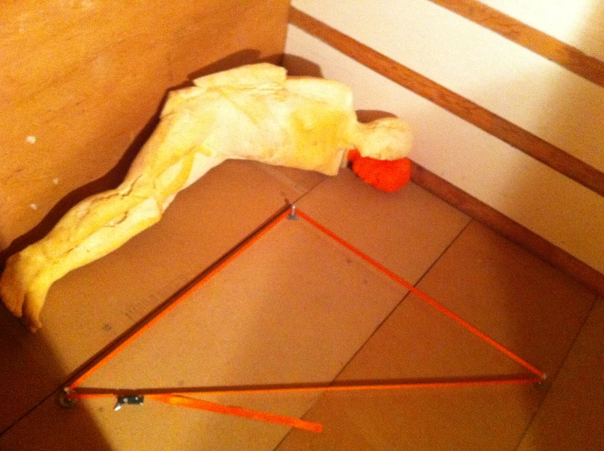

terreristal, no i didn't mean the other. please don't make me repeat your correction. will the dictionary rule us all?

IMG_0150

[original flickr post](https://www.flickr.com/photos/edwardgsharp/5156490499/)
