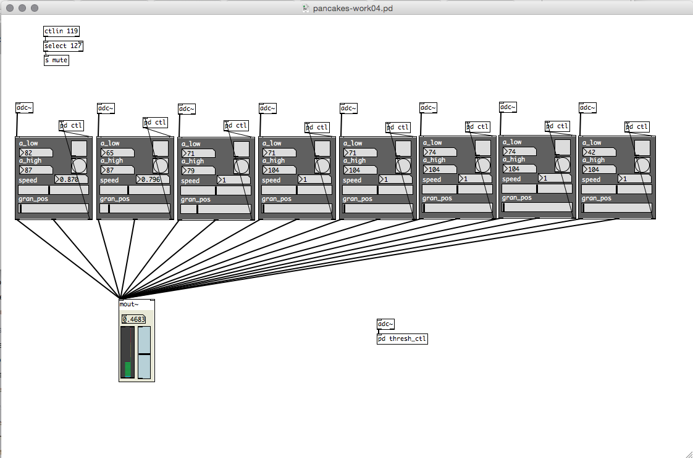

infiltration lab <a href="http://infiltrationlab.com/">http://infiltrationlab.com/</a> 

<a href="https://github.com/breedx2/pure-data/commit/132c098df3a42e8442b6d2afde084ee9e6d8399e">https://github.com/breedx2/pure-data/commit/132c098df3a42e8442b6d2afde084ee9e6d8399e</a> 

