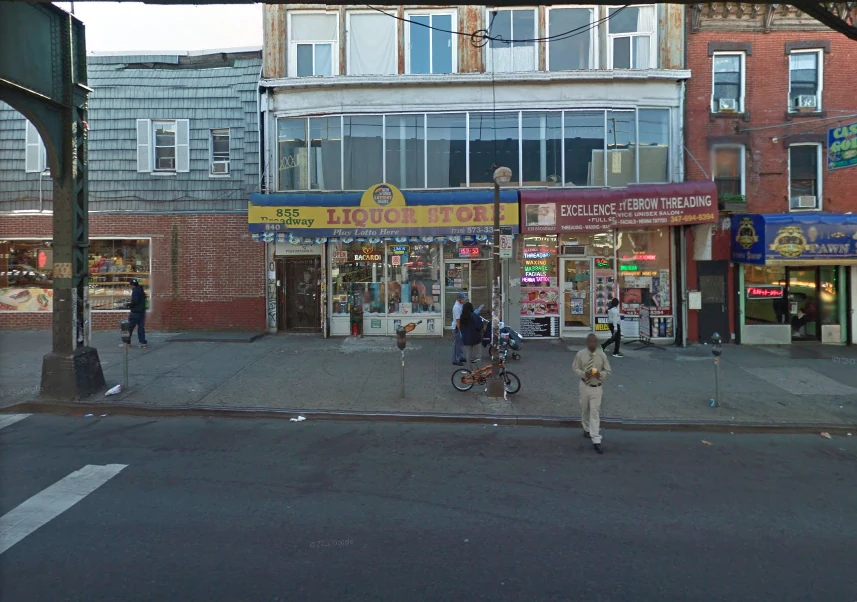

## SPACE

## ∩

**## TIME**

**@panoply performance laboratory**

**tuesday may 29, 2018**

## @grace space 840 Broadway, Brooklyn, NY

**##**

## sunday, january 28, 2018 1-4pm

## invitation for a 10 minute performance

anyone (you) can sign up for 10-minute time slot to perform anything.

-or-

come watch anything transpire.

there will be 10 available time slotz (with a scheduled break in-between) that are first-come first-served.

space, time, and refreshment/snackz provided.

very limited tech.

$free #DIY #volitionally #gregarious

…remember that time there was a regular performance art open mic at panoply? well, this is kindof a reboot of that. i (3dwardsharp) hope that this doesn’t dissolve into a regular occurrence of guitar-ing. i do hope that people try out short bitz of whatever they might be working/thinking/feeling. not an end & not really a start but maybe somewhere in-between. a way to see what your friendz are up to. a way to dip your toe, as it were. an excuse to come together to see practice, to see process, to feel incomplete, to stew in this incompleteness.

\*a note on feedback: there will be no formal feedback.

##

hello! hope you can make it to SPACE ∩ TIME the last sunday of this month @GraceSpace from 1-4pm!! here’s a link with some info: [https://gist.github.com/edwardsharp/d2d0e3c1afad1552146f087dcbbb1245#file-spacentime-md](https://gist.github.com/edwardsharp/d2d0e3c1afad1552146f087dcbbb1245#file-spacentime-md)

ohai! so i’m trying to start this performance art therapy group thing which is kindof a reboot of the open-mic-performance thingz that used to happen at panoply. ANYHOW, if yr free the last sunday of this month and want to convene (to show anything, if you’d like, and watch other thingz) at grace space from 1-4pm then please come! here’s a link with some info: [https://gist.github.com/edwardsharp/d2d0e3c1afad1552146f087dcbbb1245#file-spacentime-md](https://gist.github.com/edwardsharp/d2d0e3c1afad1552146f087dcbbb1245#file-spacentime-md)

ohai! so i’m trying to start this performance art therapy group thing which is kindof a reboot of the open-mic-performance thingz that used to happen at panoply. you probably have like a million thingz going on BUT if yr free the last sunday of this month and want to convene (to show anything, if you’d like, and watch other thingz) at grace space from 1-4pm then please come! here’s a link with some info: [https://gist.github.com/edwardsharp/d2d0e3c1afad1552146f087dcbbb1245#file-spacentime-md](https://gist.github.com/edwardsharp/d2d0e3c1afad1552146f087dcbbb1245#file-spacentime-md)
