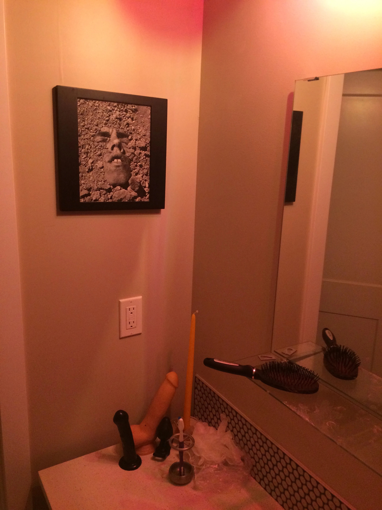

jesusfuck on what todo:

last part of 0033 1 ezz (like 40:27–)

twn-drm-jamm??

free arp?

modjamm16

anacoluthon

yell shit? hardcore shit? like what?

**futuredeath.agency**

1. (a) list (for) all (of) the time; a manual;
2. find a dumpster; find food; find yrself;
3. zip tiez, like, the really big zip tiez, probably need like 4 to 6 & some thick plastic bagz
4. helium doesn’t feel like suffocating {{citation needed}}
5. remember a typewriter (maude)
6. bawdy bob mackie gown (don’t tell anyone yr exit plan)

wtf does a good note do, for me anyway

how fast is too hard; how slow is too soft;

but, like, word play: who r u

what to do here, or there, or whenever u like

on making movement: on making sound: on making discussion:

on collaboration or whatever

make a form that people like ohyeah, make what people like

on keeping to yrself: hmm u sure?

on relative structure: watch out for recursion

and again, on what to do: «…»

“so, whose perceptual problem is this?”

