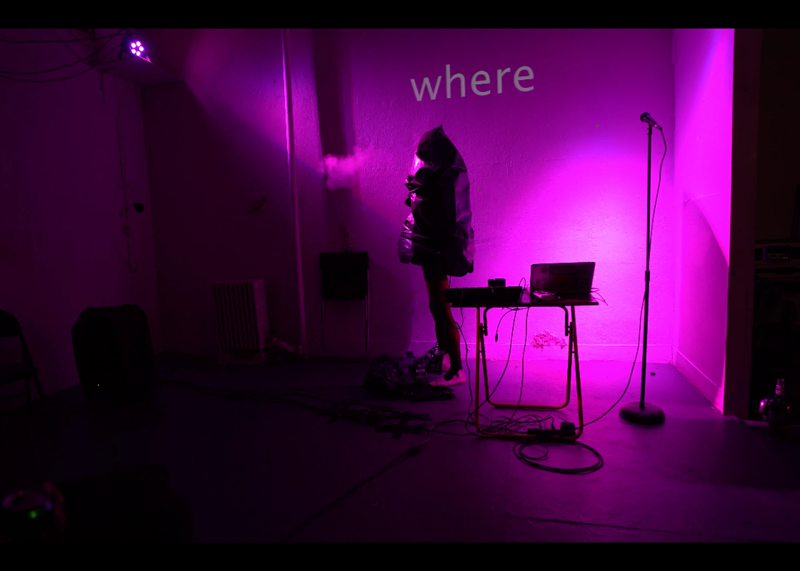
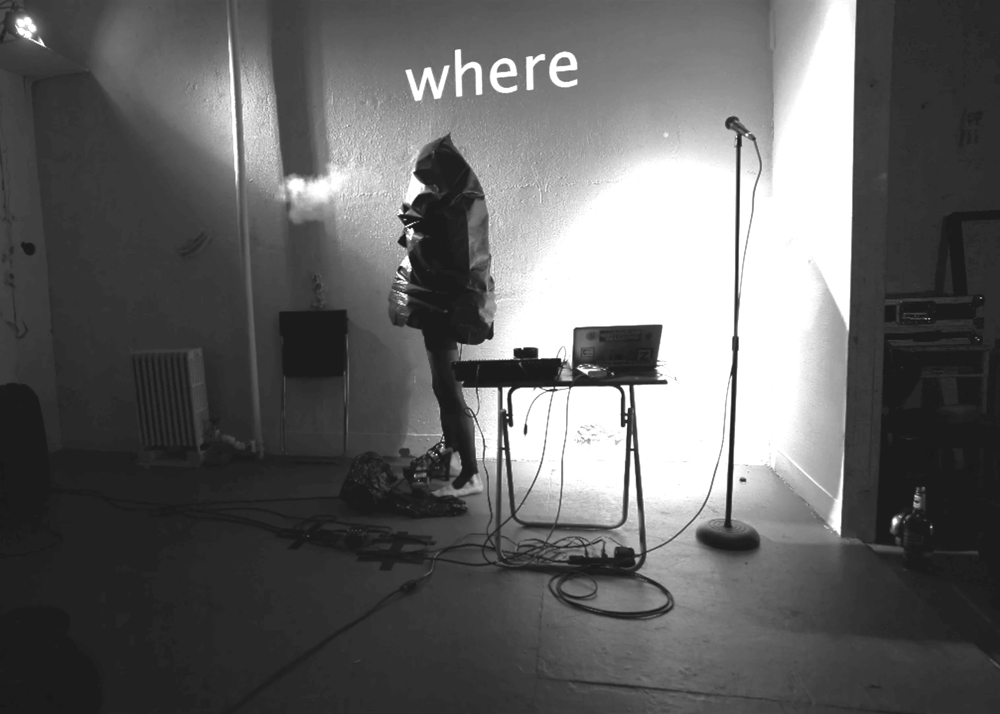

## emergency INDEX fd_a submission

february 1st

«death & respiratory distress»

http://futuredeath.agency

or also i’m like, nah, imma see old 1. (a) list (for)

death can be comfortable all (of) the time; a manual;

just gotta wear it right 2. find a dumpster; find food;

(i know, right?) find yrself;

you know what they say about people who talk to catz? 3.

(i hope it’s not true.) zip tiez, like,

anyhow: the really big zip tiez, probably need like 4

homesexualz & vicodin to 6 & some thick plastic bagz

you’re necessary 4. helium doesn’t feel like suffocating

blood {{citation needed}}

blood stainz 5. remember a typewriter (maude)

my blood 6. bawdy bob mackie gown

stainz (don’t tell anyone yr exit plan)

your necessary wtf does a good note do, for me anyway

blood how fast is too hard; how slow is too soft;

blood stainz but, like, word play: who r u

my blood what to do here, or there, or whenever u like

sit, on making movement: on making sound: on making discussion:

stand, on collaboration or whatever

sit, make a form that people like ohyeah, make what people like

stand on keeping to yrself: hmm u sure?

on relative structure: watch out for recursion

and again, on what to do: «…»

&quotso, whose perceptual problem is this?"

or also i’m like, nah, imma see old 1. (a) list (for)

death can be comfortable all (of) the time; a manual;

just gotta wear it right 2. find a dumpster; find food;

(i know, right?) find yrself;

you know what they say about people who talk to catz? 3.

(i hope it’s not true.) zip tiez, like,

anyhow: the really big zip tiez, probably need like 4

homesexualz & vicodin to 6 & some thick plastic bagz

you’re necessary 4. helium doesn’t feel like suffocating

blood {{citation needed}}

blood stainz 5. remember a typewriter (maude)

my blood 6. bawdy bob mackie gown

stainz (don’t tell anyone yr exit plan)

your necessary wtf does a good note do, for me anyway

blood how fast is too hard; how slow is too soft;

blood stainz but, like, word play: who r u

my blood what to do here, or there, or whenever u like

sit, on making movement: on making sound: on making discussion:

stand, on collaboration or whatever

sit, make a form that people like ohyeah, make what people like

stand on keeping to yrself: hmm u sure?

on relative structure: watch out for recursion

and again, on what to do: «…»

&quotso, whose perceptual problem is this?"
