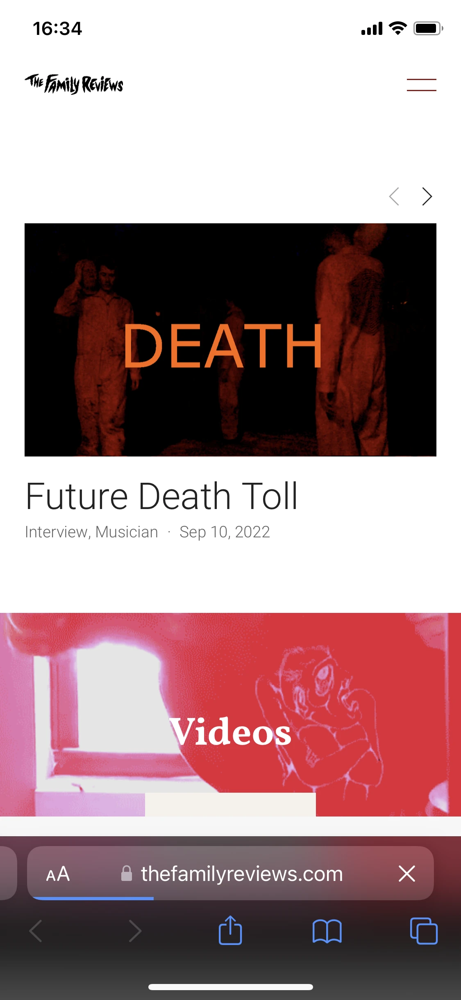

uh, so f-dt did an interview for this online zine [the family review](https://www.thefamilyreviews.com/features/future-death-toll) around the time [dead still](https://futuredeathtoll.bandcamp.com/album/dead-still) was released

---

Would you rather…
eat pizza you picked up from the subway stairs or lick the bottom of every subway seat?
av: don’t think so.

3dwardsharp: i guess lick the bottom of every subway seat, that'd be quite the feat, there's gotta be like thousandz of subway seatz out there!

™: wut kind of pizza?

Some questions with Future Death Toll
Can you give us a little more backstory on your project future death toll?
av: me, 3dwardsharp, and tozz met in a sculpture class in lincoln, nebraska in like 2006. we would stay up late into the night working on class projectz and listening to music. we were going to a lot of midwest grindcore, powerviolence, and noise showz together. a little while after this time we started experimenting with making sound, video, sculpture installation/enviromentz, performance art, and life body casting together.

3dwardsharp: around that time i went to tozz's house and found he had a pretty amazing cd collection with pretty much all the same 90s industrial music that i grew up listening to so it was kinda love at first sight. tozz also had a blue and red korg electribe synth/drum machine so we started jamming. we all moved out to portland, or where we met twon and started jamming together and recording more stuff. av moved out to nyc at some point and 3dwardsharp would follow along a few years later. we've had a variety of other collaboratorz come and go thru the years.

™: met them in pdx 09’ or 10’. We had similar interests in our aesthetic tastes, music, film, humour, etc. and began hanging out more often and collaborating on recordings, performance, installation, printmaking, sculpture, etc.

Who would be your dream collaborator?
av: Jim Nash and Dannie Flesher of Wax Trax! Records would be one.

3dwardsharp: a roadie for GWAR or help work on the music & sound-fx for a video game.

™: Harmony Korine or Richard D. James

What kind of gear did you lean on when recording the tracks for your release “dead still”
av: i record a lot vox with a old rotary telephone handset outfitted with a ¼” output on it but i also have used traditional micz and the mic built into a computer laptop. some fx pedalz and post fx. i recorded myself hitting metal chain against wooden stairs for GHOST_RIDER_2099.

3dwardsharp: oh so some software thingz like: pure data, ableton live, reason, tweaky beatz, this 909 iphone app; hardware thingz like: bucha random eurorack modulez, death metal distortion and this gender bender vocal fx pedal, field recordingz and uncleared samplez. this release features vocals in every track which isn't something we did before; so a lot of attention was paid to that aspect.

™: korg es-1, mother 32, mc-303, synth plus 10, kp3, avalanche run

Do you have an unpopular opinion you’d like to share? What is it?
f-dt: probably; and no.

Who were you listening to when writing/recording your latest album “dead still”?
f-dt: soundz of the everyday and the city environment. silence can be a sound. otherwise: crisis sigil, the gay agenda, backxwash, G.L.O.S.S., LustSickPuppy, deli girls, arca, suicide, revolting cocks, skinny puppy, front 242, nitzer ebb, haus arafna, throbbing gristle, mykki blanco, cakes da killa, m.i.a., type o negative, pharmakon, soft cell, machine girl, consumer, atari teenage riot, ec8or, panther modern, missy elliott, duran duran, nine inch nails, jessie reyez, that yeah yeah yeahs demo tape, judas priest, mf doom, sleaford mods, lightning bolt, j. cole's 2014 forest hills drive, plack blague, ministry, scott walker, leikeli47, beverly glenn-copeland, saul williams, genocide organ, zeigenbock kopf, ho99o9, death grips, container, angel haze, princess nokia, power trip, green velvet, kmfdm, men's recovery project

Has a song ever made you angry? Do you know why it made you mad?
av: there are songz that get the blood pmping but idk if i would call the emotion they elicit anger.

3dwardsharp: i always get irrationally angry hearing the beatles, i guess because it feelz so worn out?

™: overplayed mainstream “popular music”

What is the current state of the DIY noise scene in NYC right now?
av: DIY or DIE is all around us and ever mutating.

3dwardsharp: i want to believe it's thriving! nyc can be a harsh place for DIY.

You included a cover of Suicide’s “Ghostrider” on your album. Would you say that project is a big influence on the music you are putting out under future death toll?
av: samplez and coverz play an pretty important role in threading together sound making history. suicide has made pretty substantial contributionz to sound, performance, and visual art. they were a memorable band to see live.

3dwardsharp: yeah sure; also a lot of other people have covered and sampled it, too (so that's pretty neat).

™: one of many important influences

If you had control of all bats on the earth what would you do with them?
f-dt: relinquish control immediately.

What was your most memorable performance to date, and why?
av: I have forgotten a lot (bc you know time) but i remember when we were just starting out in like 07-08 we played a sportz bar in nebraska in like the afternoon/early evening? only a few people were there (possibly to drink and play sportz) and someone came up to the edge of the stage and just started yelling, “stop!” over and over. in 2014 we performed on a bill with COCK E.S.P., that was also pretty memorable/fun to watch. that was when we were on tour with Panoply Performance Lab for a whole month in march and it was pretty cold out.

3dwardsharp: lolol, yeah those performances were pretty memorable for me, too. one time i got this gas-powered chipper/shredder off craigslist and that we did this like, fargo thing, as a part of a performance; it was super-dangerous-and-totally-not-even-worth-it :/

™: chipper shredder was very memorable. There was some other highlights for me, like some full body casting, cutting a couch in half w a sawzall, making the jump on halloween, and the techne rendered dawn performance.
