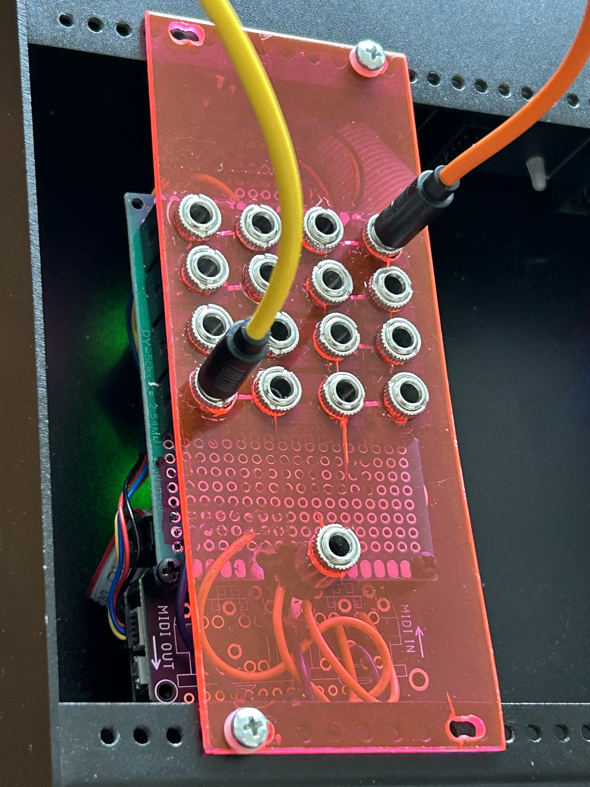

zomg, i made a midi in and 0-5v CV voltage out eurorack module! i got a pink clipboard from the dollar store and made the panel. got a little messed up with the 2 variationz of the 3.5mm TTRS midi connector tho...
