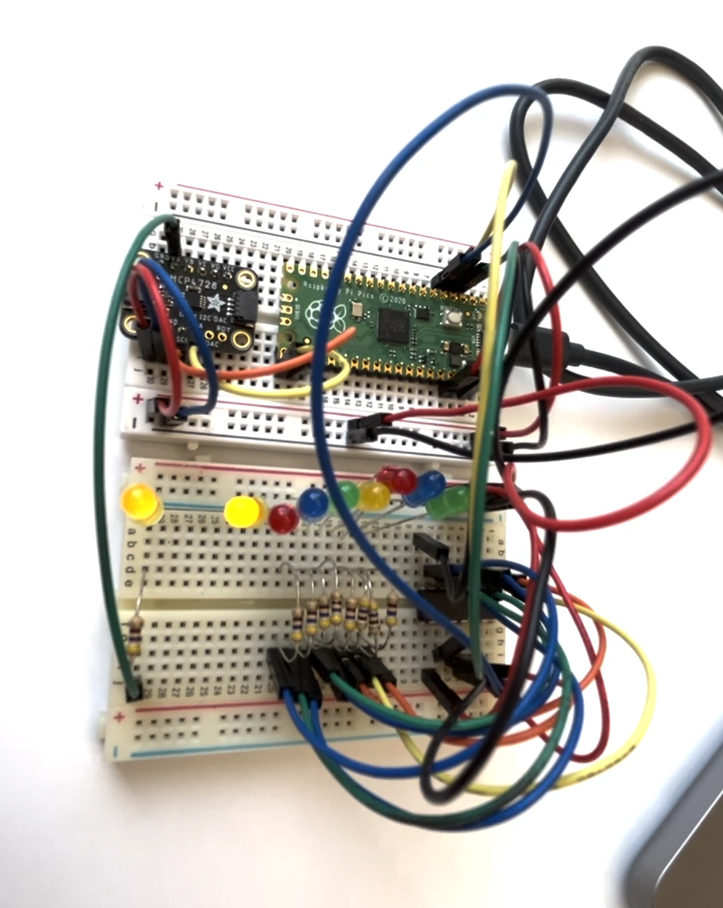
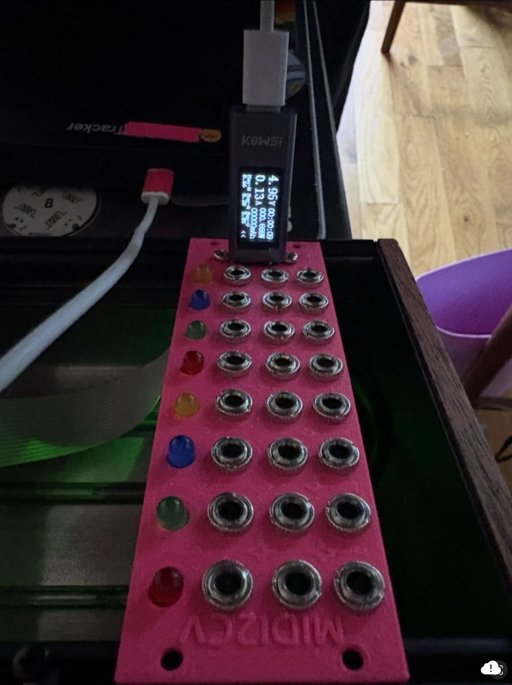
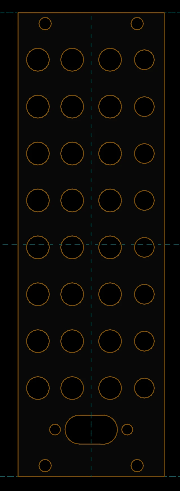
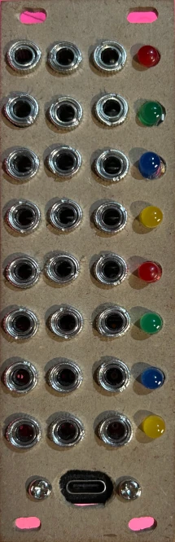

# MIDI2CV

just some musing on a midi to cv (control voltage) converter for eurorack.

this is the code for the second revision. which uses usb midi!

there's 4 mcp4728 DACs that provide 16 channels of control voltages (0-5v). 8 of those are for notes, the other 8 are for note velocities, and the other 8 are gates (the gates and leds are controlled via a [74HC595 shift register](https://www.adafruit.com/product/450)). there's a usb midi interface which uses [adafruit's rp2040 with usb host board](https://learn.adafruit.com/assets/120411). the [EZ_USB_MIDI_HOST](https://github.com/rppicomidi/EZ_USB_MIDI_HOST/) handles usb midi and uses the [sekigon-gonnoc/Pico-PIO-USB](https://github.com/sekigon-gonnoc/Pico-PIO-USB) library (programmable input/output) as a [bit-bangin'](https://en.wikipedia.org/wiki/Bit_banging) software usb host controller.

**IMPORTANT NOTE:** i ended up using v`0.5.3` of this library because the newest version (v`0.6.0` at the time of writing this) was very unstable [read more in this github issue](https://github.com/sekigon-gonnoc/Pico-PIO-USB/issues/122).

i also ran into another dead end where my rp2040 would crash when sending i2c data to more than one mcp4728 DAC so i used another rp2040 (a [kb2040](https://learn.adafruit.com/assets/106984), that adafruit sent me as a freebie) to do the i2c communication with the DACs and use serial UART between the two rp2040s. :feelsgood:

_so please note:_

1. `midi2` is the arduino sketch for the [rp2040 with usb host](https://www.adafruit.com/product/5723)
2. `2cv` is the arduino sketch for the [kb2040](https://www.adafruit.com/product/5302)

**see also** rev2 now with more rust: [github.com/edwardsharp/midi2cv/pull/1](https://github.com/edwardsharp/midi2cv/pull/1)

