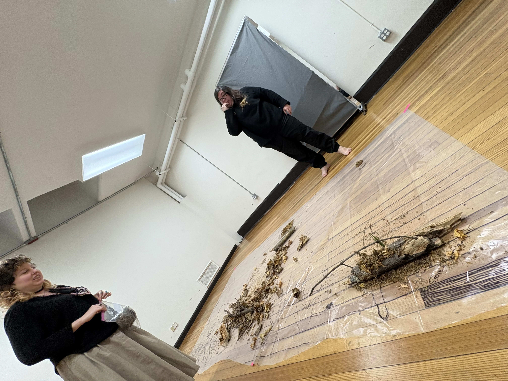
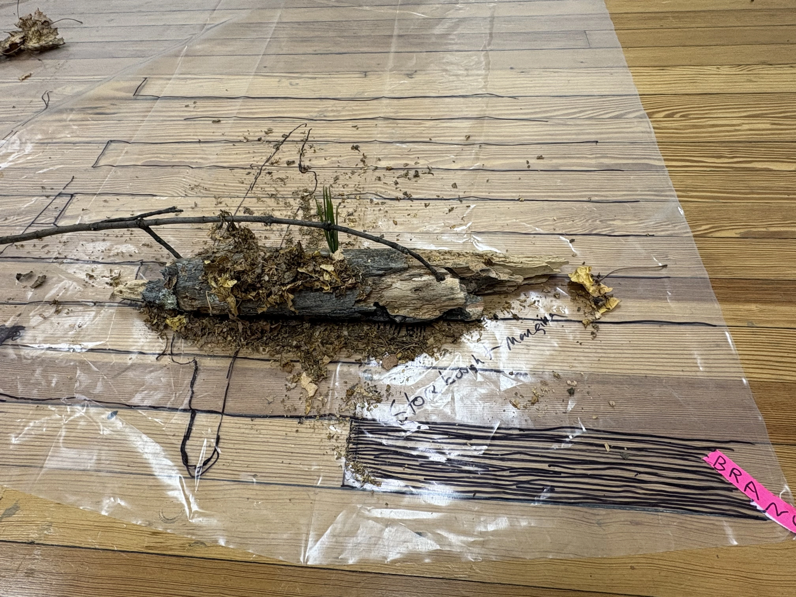

i, uh, filled woodpecker holez with ground up leaves & spit; while on a zoom call to a room full of georgetown studentz yesterday 🤷

okay, so my friend [EstheR](https://estherneff.com/) wrote this paper for this ["DECAY: The Architecture of Collapse - An English Graduate Student Conference"](https://events.georgetown.edu/english/event/43855-decay-the-architecture-of-collapse-an-english) at georgetown and thru a winding course of eventz, had to cut it down to 15 minutes and so she asked me & [Noah](https://www.bax.org/noah-ortega/) to do a performance alongside. so we were at a studio at abrons art center (in nyc) and had some trinkets (like leaves and branches, a là Marilyn Arsem) collected from our recent adventurez along the hudson river; so EstheR played a recording of her reading the paper and we did little actions while filming with our cellphonez on a zoom call while a gaggle of students from georgetown watched.
